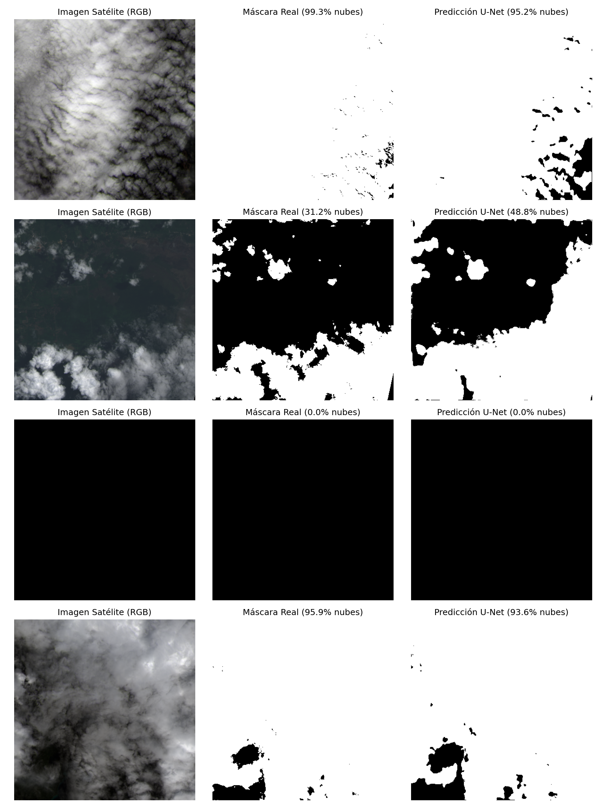

# Cloud Segmentation with U-Net

Proyecto de visión por computador enfocado en la segmentación de nubes sobre imágenes satelitales utilizando redes neuronales convolucionales (U-Net) en PyTorch.

## Objetivo
Entrenar un modelo capaz de recibir un parche de imagen satelital y generar una máscara binaria que identifique con precisión la cobertura nubosa, sirviendo como base técnica para el procesamiento de datos geoespaciales y meteorológicos con Deep Learning.

## Tecnologías
- **Lenguaje:** Python 3
- **Deep Learning:** PyTorch
- **Procesamiento y Visualización:** NumPy, Matplotlib, Pillow, tqdm
- **Entorno de entrenamiento:** Google Colab (GPU Tesla T4)
- **Dataset:** 38-Cloud

## Estructura y Guía de Archivos del Proyecto

```text
cloud-segmentation-unet/
├── assets/
│   └── resultados_segmentacion.png
├── notebooks/
│   └── 01_cloud_segmentation_colab.ipynb
├── src/
│   ├── __init__.py
│   ├── dataset.py
│   ├── model.py
│   └── train.py
├── .gitignore
├── requirements.txt
└── README.md
```

- **assets/resultados_segmentacion.png**: Gráfica comparativa generada tras la validación que muestra lado a lado la imagen satelital RGB, la máscara real y la predicción del modelo.
- **notebooks/01_cloud_segmentation_colab.ipynb**: Cuaderno interactivo de Google Colab con todo el flujo documentado paso a paso, análisis exploratorio de dimensiones y visualizaciones.
- **src/dataset.py**: Implementación de la clase CloudDataset (heredada de torch.utils.data.Dataset). Gestiona la carga bajo demanda (lazy loading), el apilamiento de las 4 bandas espectrales (Rojo, Verde, Azul e Infrarrojo Cercano) en formato channels-first (4, 384, 384), la normalización Min-Max al rango [0, 1] y la binarización de las máscaras.
- **src/model.py**: Definición modular de la arquitectura UNet mediante bloques DoubleConv (Conv2d + BatchNorm2d + ReLU), etapa de contracción (Encoder), cuello de botella (Bottleneck) y etapa de expansión (Decoder) con Skip Connections para preservar la resolución espacial de los bordes.
- **src/train.py**: Script ejecutable de entrenamiento parametrizado listo para entornos de servidor o clúster en GPU, encargado de dividir los datos, ejecutar el bucle de optimización y exportar los pesos aprendidos.
- **requirements.txt**: Lista de dependencias necesarias para reproducir el entorno.
- **.gitignore**: Configuración para excluir del control de versiones credenciales privadas (kaggle.json), los datos crudos y los archivos pesados de pesos entrenados (.pth).

## Memoria del Desarrollo
1. **Entorno y datos:** Configuración de la API de Kaggle en Google Colab (GPU T4) para descargar y preparar las imágenes satelitales del dataset 38-Cloud.
2. **Pipeline de carga:** Creación de un Dataset y DataLoader personalizados para combinar las 4 bandas espectrales de cada foto y entregarlas en lotes de 8 muestras.
3. **Arquitectura U-Net:** Implementación de la red neuronal verificando que las dimensiones de entrada y salida coincidieran.
4. **Entrenamiento:** División de los datos en 90% entrenamiento y 10% validación. Tras 3 épocas, el error medio del modelo bajó de 0.3571 a 0.2104.
5. **Evaluación visual:** Prueba del modelo con imágenes nuevas para comparar sus predicciones frente a las máscaras reales.
6. **Modularización:** Separación del código del cuaderno en scripts limpios y reutilizables dentro de src/.

## Resultados

Comparativa sobre el conjunto de validación entre el compuesto RGB satelital, la máscara real (Ground Truth) y la segmentación predicha por la U-Net tras 3 épocas de entrenamiento:


*resultados_segmentacion.png*
